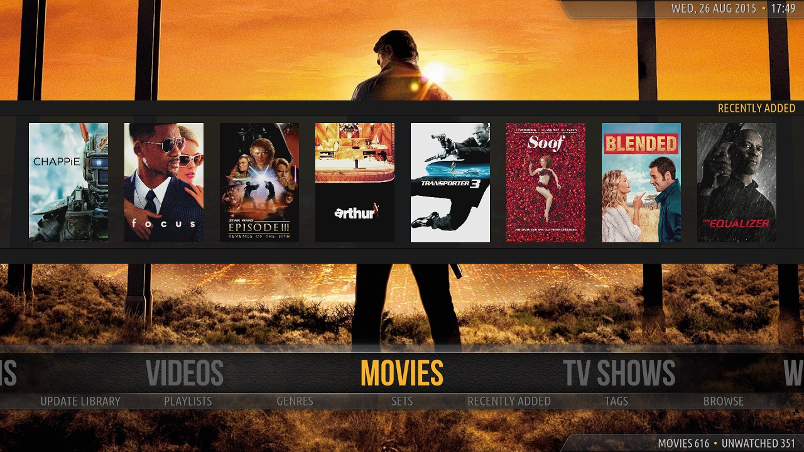
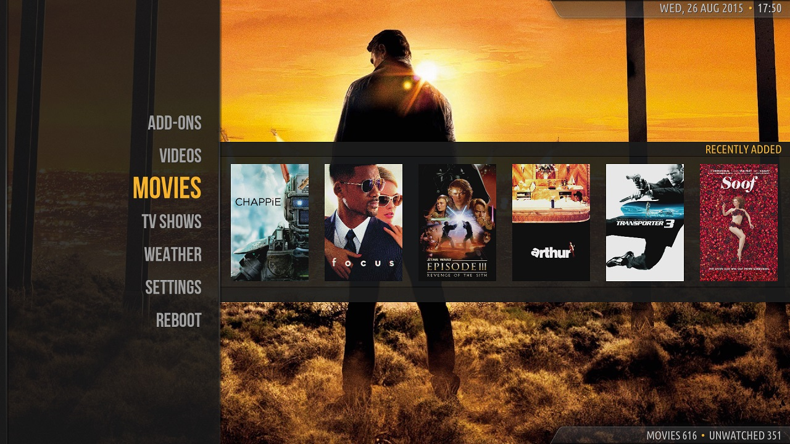
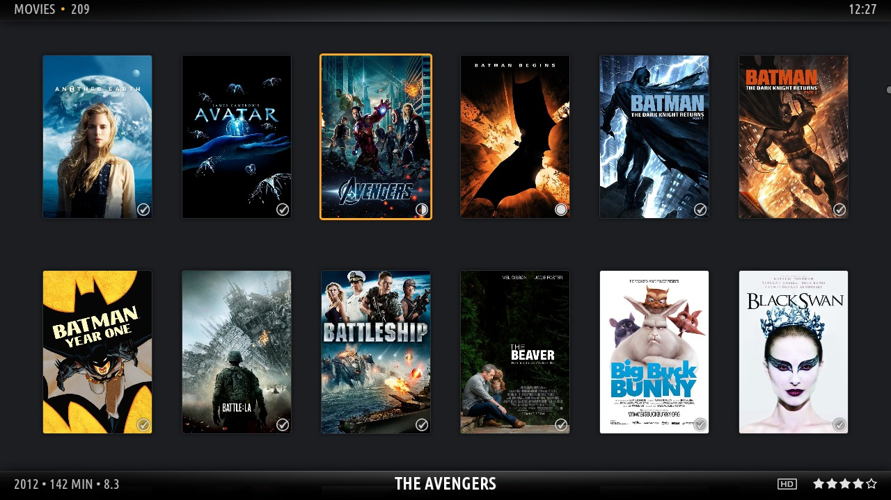
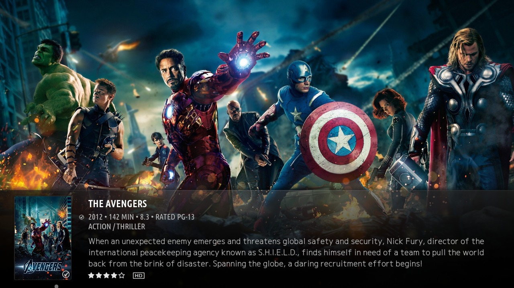
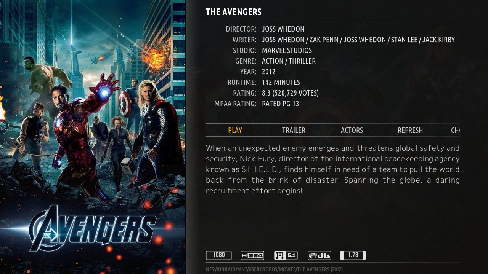
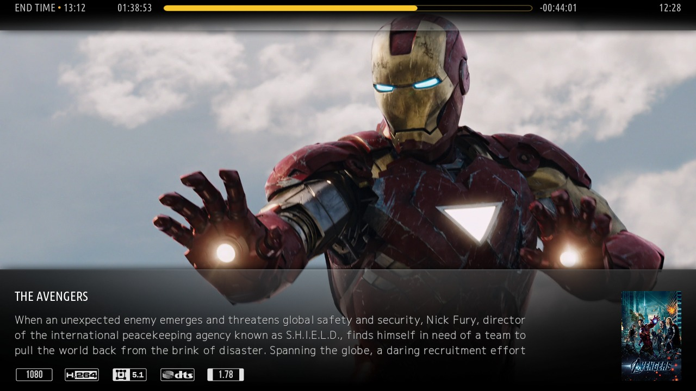
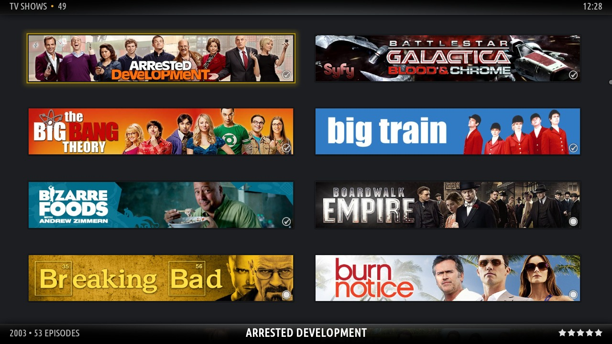
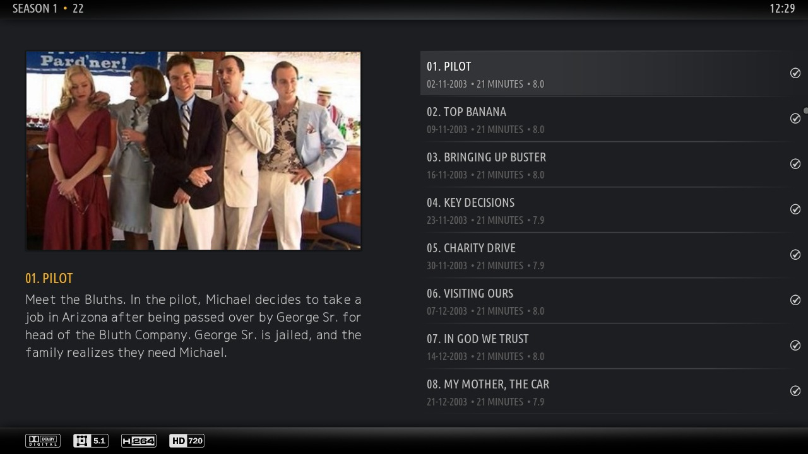
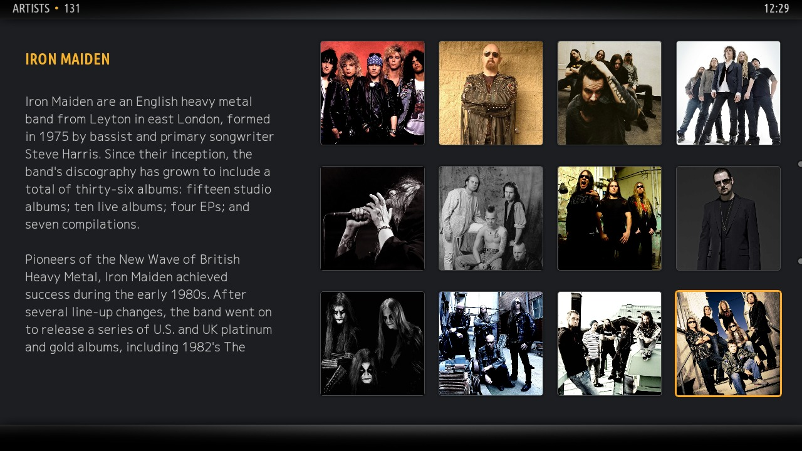
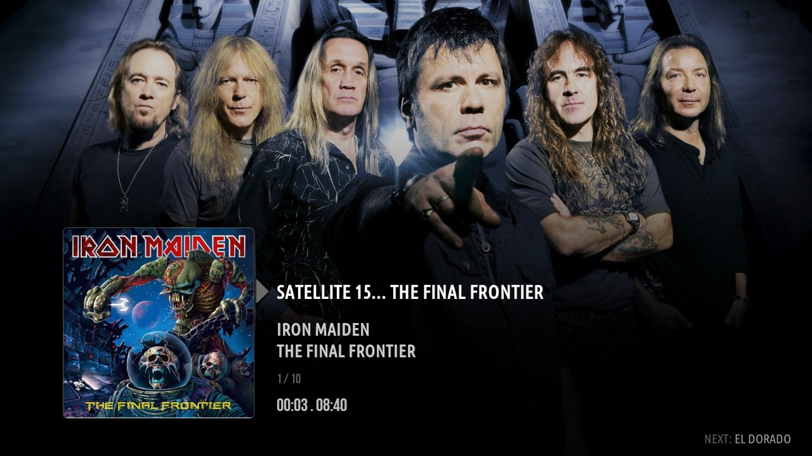

# Amber

If you enjoy this skin, [buy me a coffee](https://ko-fi.com/mikesilvo) ☕

## Install

Active development is on **Kodi 22 (Piers)**. The current version is still in beta, so install it from my dev repo:

**https://mikesilvo.github.io/repository.silvo/**

## Branches

| Branch | Kodi |
|---|---|
| `piers` | 22 Piers (default) |
| `omega` | 21 Omega |
| `nexus` | 20 Nexus |

## Support

Questions and help go in the [forum thread](https://forum.kodi.tv/showthread.php?tid=389089). Issues here are for bug reports and feature requests.

 

  
&nbsp; &nbsp; &nbsp; &nbsp; &nbsp; &nbsp;
  

  
&nbsp; &nbsp; &nbsp; &nbsp; &nbsp; &nbsp;
  

  
&nbsp; &nbsp; &nbsp; &nbsp; &nbsp; &nbsp;
  

  
&nbsp; &nbsp; &nbsp; &nbsp; &nbsp; &nbsp;
  

  
&nbsp; &nbsp; &nbsp; &nbsp; &nbsp; &nbsp;
  

